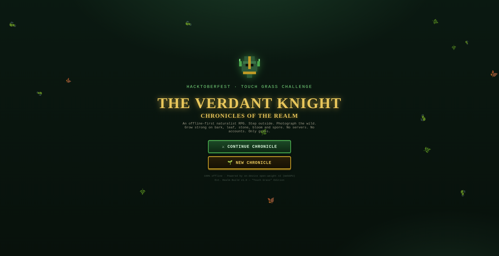

Here is the updated `README.md` configured to link directly to your local `docs/media/field-demo.mp4` file instead of YouTube:

```markdown
# 🌿 The Verdant Knight: Chronicles of the Realm

> An offline-first naturalist RPG powered by on-device open-weight AI (WebGPU).  
> Built for the **Hacktoberfest Open-Source AI Challenge — Week 1: "Touch Grass"**.

[](https://opensource.org/licenses/MIT)
[](https://github.com/huggingface/transformers.js)
[](https://developer.mozilla.org/en-US/docs/Web/API/WebGPU_API)
[](https://dev.to/challenges/hacktoberfest-week1-2026-10-05)

---

## 🎬 Demo & Downloads

* **Live Demo:** [Play The Verdant Knight](https://tahaenasraoui-debug.github.io/The-Verdant-Knight-Chronicles-of-the-Realm/)
* **Android APK:** The installable APK package is available in the GitHub Packages / Releases section: [Download APK Package](https://github.com/tahaenasraoui-debug/The-Verdant-Knight-Chronicles-of-the-Realm/releases/latest)
* **Field Test Video:** [Watch / Download Trail Demo (.mp4)](docs/media/field-demo.mp4)



---

## 🌲 Overview

Most outdoor applications encourage users to keep their eyes locked on screens—checking GPS waypoints, tweaking camera filters, or browsing social media feeds.

**The Verdant Knight** flips this dynamic entirely. It is a client-side naturalist RPG where physical exploration acts as your crafting bench and leveling system. 

Players explore outdoor trails, woodlands, or local parks with minimal screen interaction. When spotting interesting natural elements, they snap a single photograph. An open-weight vision model processes the image locally on their device, evaluates the specimen, attunes the find to one of five core elemental attributes, and logs the discovery inside a field codex.

---

## 📱 Android Installation

The standalone Android APK is bundled directly in the project packages:

1. Download the `.apk` package from [Releases / Packages](https://github.com/tahaenasraoui-debug/The-Verdant-Knight-Chronicles-of-the-Realm/releases/latest).
2. Open and install the package on your Android device (allow installation from unknown sources if prompted).
3. Grant camera permissions upon launch.
4. Open the app once while connected to the internet to cache the model weights (~15 MB). After that, the game functions completely offline.

---

## ⚔️ The Naturalist Stat Matrix

Physical flora and landscape elements map directly to your character's RPG attributes and equipment tiers:

| Specimen Category | Primary Stat | Equipment Slot Unlocked | Lore & Aesthetic |
| :--- | :--- | :--- | :--- |
| **Bark & Timber** | **DEF (Defense)** | Cuirass & Plated Armor | Rough ironwood pauldrons, split-oak cuirass |
| **Foliage & Needles** | **DEX (Agility)** | Cloaks & Wraps | Wind-runner mantles, woven briar hoods |
| **Stones & Minerals** | **STR (Strength)** | Weapons | Flint daggers, basalt maces, granite blades |
| **Flowers & Berries** | **WIS (Wisdom)** | Amulets & Circlets | Amber pendants, seed talismans, floral circlets |
| **Fungi, Moss & Lichen** | **END (Endurance)** | Shields & Belts | Lichen-woven sashes, mycelium spore aegis |

---

## 🎮 Key Features

- **Designed for Zero Screen Time:** 
  - Trail Mode features a single primary shutter button.
  - Haptic confirmation pulses (`navigator.vibrate([100, 50, 100])`) allow players to confirm captures by touch without looking at a screen mid-walk.
- **Client-Side Open-Weight Vision Model:**
  - Evaluates photographs using a quantized **MobileNetV4** neural network model running in-browser via **Transformers.js v3** and **WebGPU** (with automatic WASM fallback).
  - No external cloud APIs, no network requests, and zero telemetry leaving the device.
- **Dynamic Paper-Doll Pixel Avatars:**
  - Full character creation featuring archetypes, skin tones, hairstyles, colors, and war markings.
  - Unlocked and equipped gear visually updates directly on the avatar's canvas.
- **The Field Codex:**
  - A collectible field guide recording rarity tiers (Common to Legendary), scientific classifications, and discovery logs.
- **Persistent Offline Progress:**
  - Entire application state, unlocked relics, inventory, and codex entries persist locally via `localStorage`.

---

## 🧠 Why Open Innovation Matters

Trail exploration and deep backcountry routes often have spotty or nonexistent mobile reception. 

1. **True Offline Edge Execution:** Cloud-hosted models fail completely without active internet. By leveraging open-weight ONNX models with WebGPU acceleration, inference runs anywhere in nature with zero latency.
2. **Location Privacy by Design:** Outdoor photographs contain embedded GPS coordinates and temporal patterns. Processing images on-device ensures no personal visual or geographical data is shared with third-party cloud endpoints.
3. **Zero Marginal Costs:** Runs on hardware you already own at zero operational cost per inference.

---

## 🚀 Quickstart & Local Setup

Because the application utilizes modern ES Modules and WebGPU via browser workers, it must be served over an HTTP connection rather than opened directly via `file://`.

### 1. Clone the Repository

```bash
git clone [https://github.com/tahaenasraoui-debug/The-Verdant-Knight-Chronicles-of-the-Realm.git](https://github.com/tahaenasraoui-debug/The-Verdant-Knight-Chronicles-of-the-Realm.git)
cd The-Verdant-Knight-Chronicles-of-the-Realm

```

### 2. Start a Local Server

Run a local server with Python:

```bash
# Python 3
python3 -m http.server 8000

```

Or using Node.js / `npx`:

```bash
npx serve .

```

### 3. Open in Browser

Open your browser and navigate to:

```
http://localhost:8000

```

*Note: On your first load, the browser downloads and caches the quantized model weights (~15 MB). Subsequent runs will function completely offline.*

---

## 🛠️ Technology Stack

* **Runtime & AI Pipeline:** [Transformers.js v3](https://github.com/huggingface/transformers.js) (`@huggingface/transformers`)
* **Model Backbone:** `onnx-community/mobilenetv4_conv_small.e2400_r224_in1k`
* **Graphics & Rendering:** HTML5 Canvas (Pixel-Art Engine)
* **Audio:** Web Audio API (Synthesized procedural retro 8-bit chimes)
* **Haptics:** Web Vibration API
* **Persistence:** Browser `localStorage`

---

## 📜 License

This project is open-source and available under the [MIT License](https://www.google.com/search?q=LICENSE).

```

Just ensure your video file is committed at `docs/media/field-demo.mp4` (or adjust the path in the link if your file is named differently).

```
